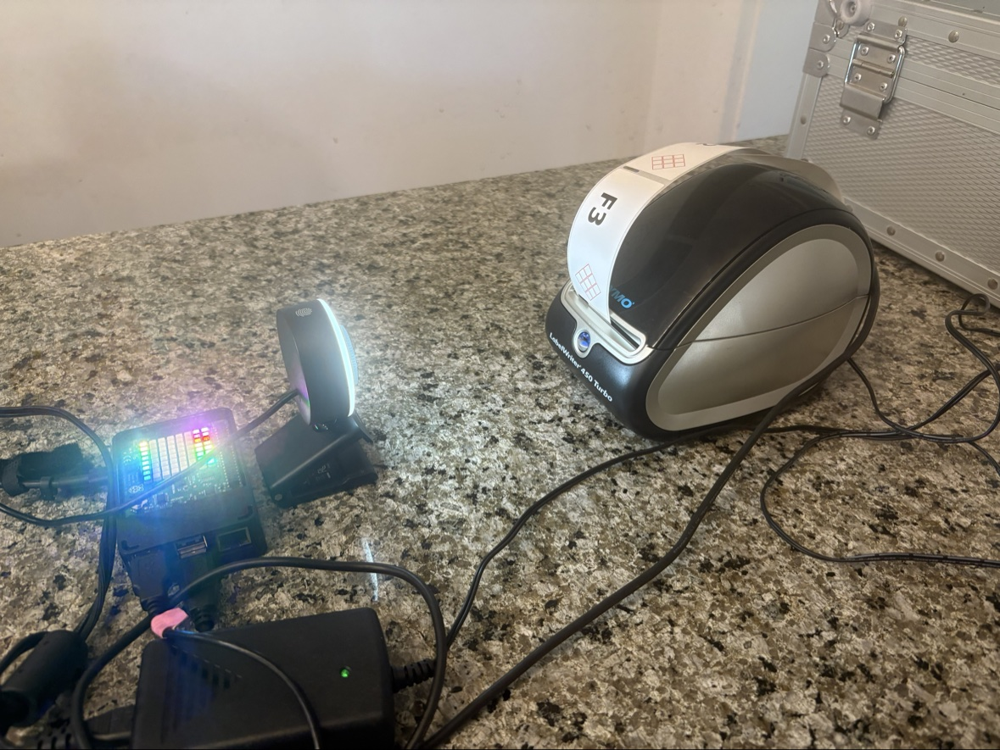

# muse-print

Print text labels on a **Dymo LabelWriter 450 Turbo** from a Raspberry Pi —
with drift-free label registration, so back-to-back prints always land
exactly where the first one did.

```bash
pip install muse-print
muse-print "Giulia"
```

## The one-line summary

Normal Linux Dymo printing (`dymoprint`) positions the tear point by
**counting blank lines from the host** — and any tiny pitch error
accumulates with every label. muse-print instead ends each print with a
**Form Feed** (`ESC E`, `0x1B 0x45`): the printer's firmware uses its own
label-gap sensor to find the next gap and stops exactly at the tear bar.
It's the USB equivalent of pressing the printer's physical button — and it
means every label starts from the same condition, no matter how many you
print in a row.

## Start here

- **[Quickstart](quickstart.md)** — install on a fresh Pi, print your first label
- **[The Journey](the-journey.md)** — the full engineering story: the driver hunt, the drift, the camera, the breakthrough
- **[Drivers](drivers.md)** — what gets installed and why (Debian trixie gotchas)
- **[ESC E deep dive](esc-e.md)** — the Form Feed discovery, in technical detail
- **[The camera loop](camera.md)** — how a USB microscope camera made the printer observable
- **[Chemical labels](chemical-labels.md)** — GHS hazard diamonds: pictograms, blackouts, and a compliant SLS label
- **[Python API](api.md)** — `muse_print` as a library

## The setup



*The autonomous learning loop in action: Raspberry Pi 4 with Sense HAT
(rainbow LEDs) running the Muse Gadget, USB microscope camera aimed at the
Dymo LabelWriter 450 Turbo, with a freshly printed "F3" test label coming
out. Print, photograph, measure, adjust — without touching the printer.*

## Status

- Tested on Raspberry Pi 4, Debian 13 (trixie), Dymo LabelWriter 450 Turbo (USB ID `0922:0021`)
- Camera-verified: 3 consecutive prints land identically
- `pip install muse-print` — PyPI release pending

[GitHub](https://github.com/marcocaggioni/muse-print) ·
[Philosophy](https://github.com/marcocaggioni/muse-print/blob/main/PHILOSOPHY.md)
